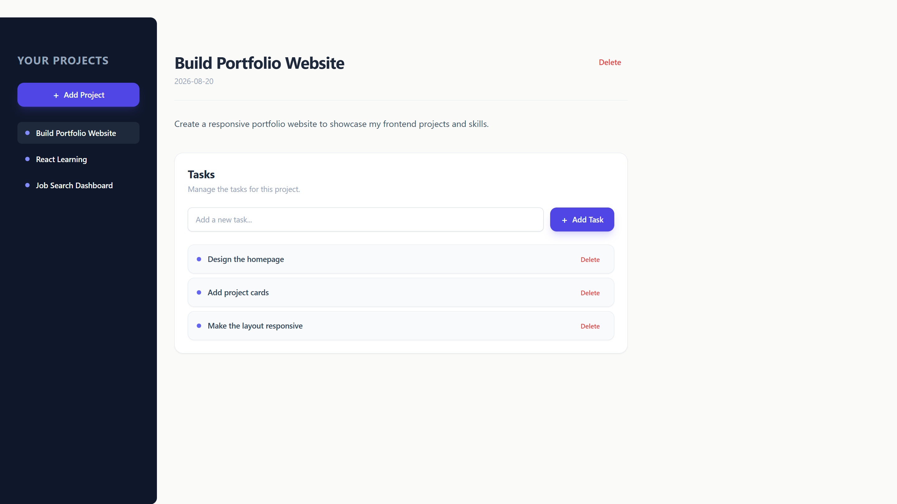
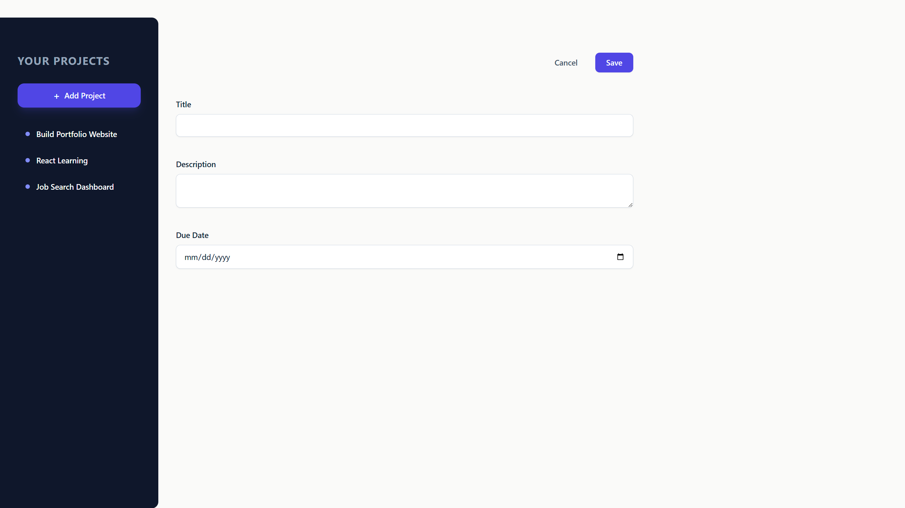

# React Project Manager

A responsive project and task management app built with React and Tailwind CSS. This project focuses on component composition, state management, refs, forwarded refs, and React portals.

# Screenshots




## Features

- Create projects with a title, description, and due date
- Select a project from the sidebar to view its details and tasks
- Add and delete tasks within a project
- Delete an entire project
- Form validation with a modal dialog using `forwardRef`, `useImperativeHandle`, and `createPortal`
- Responsive layout across desktop and mobile screen sizes
- Desktop sidebar with a fixed project navigation panel
- Mobile slide-out sidebar with an overlay backdrop
- Reusable button and input components

## Responsive Design

The application adapts its layout depending on screen size:

- Desktop layout with a fixed project sidebar
- Mobile slide-out navigation menu
- Overlay backdrop when the mobile menu is open
- Responsive spacing, typography, and component sizing using Tailwind CSS

## Tech Stack

- [React](https://react.dev/) — UI library
- [Vite](https://vite.dev/) — build tool and development server
- [Tailwind CSS](https://tailwindcss.com/) — styling

## Getting Started

### Prerequisites

- [Node.js](https://nodejs.org/) (v18 or later recommended)
- npm (included with Node.js)

### Installation

Clone the repository:

```bash
git clone https://github.com/alaa-a-mo/react-project-management-app.git
```

Move into the project directory:

```bash
cd react-project-management-app
```

Install the dependencies:

```bash
npm install
```

### Running the App

Start the development server:

```bash
npm run dev
```

Then open the URL shown in the terminal, usually:

```text
http://localhost:5173
```

## Project Structure

```text
src/
├── assets/
├── components/
│   ├── Button.jsx
│   ├── Input.jsx
│   ├── Modal.jsx
│   ├── NewProject.jsx
│   ├── NoProjectSelected.jsx
│   ├── ProjectSidebar.jsx
│   └── SelectedProject.jsx
├── App.jsx
├── main.jsx
└── index.css
```

## What I Practiced

This project was built to practice advanced React concepts, including:

- Lifting state up and managing shared application state
- Passing data and event handlers between components
- Component composition and reusable components
- `useState` for managing application state
- `useRef` for uncontrolled form inputs and DOM access
- `forwardRef` for forwarding refs to reusable components
- `useImperativeHandle` for exposing imperative methods from child components
- `createPortal` for rendering modal content outside the normal component tree
- Form validation and user feedback
- Immutable state updates with arrays and objects
- Building responsive layouts with Tailwind CSS
- Creating a mobile slide-out navigation menu with an overlay backdrop

## License

This project was created for personal learning and practice.
